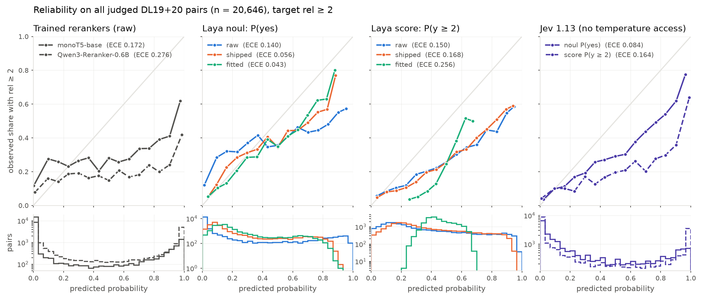
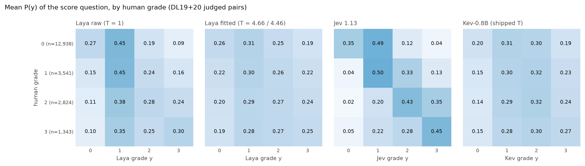

# Decision models as zero-shot rerankers

Can a decision model rerank passages without retrieval training, and are its relevance probabilities
calibrated? Decision models answer typed questions (noul = yes/no, score = rubric, choice) with
probabilities instead of text. This repo tests three of them as pointwise rerankers on TREC DL 2019/2020:
TypeSafe's closed **Jev 1.13** (through OpenRouter) and two open Jev-like models, **Laya**
(`convaiinnovations/laya`, ModernBERT-large, 421M) and **Kev-0.8B** (`jaredpalmer/kev-0.8b`, a LoRA
adapter on Qwen3.5-0.8B-Base, size-matched to Qwen3-Reranker-0.6B). They are compared with two
rerankers trained on relevance data.

- **RQ1 (effectiveness).** How do zero-shot decision models compare with monoT5-base and
  Qwen3-Reranker-0.6B when reranking the official TREC DL passage rerank pool? Do the question type and
  the rule that turns an answer into a score matter?
- **RQ2 (calibration).** Are their relevance probabilities calibrated against the human DL labels, as
  shipped and after temperature scaling, and how do they compare with the trained rerankers'?

## Setup

| Component | Choice |
| --- | --- |
| Collections | TREC DL 2019 (43 judged queries, 9,260 judged pairs) and DL 2020 (54, 11,386); MS MARCO v1 passage; grades 0-3 |
| Candidates | Official rerank-subtask pool, `msmarco-passagetest{2019,2020}-top1000` (up to 1000 per query; 41,042 + 50,024 pairs). The files are unranked, so the BM25 baseline and all tie-breaks use our bm25s scores over the pool (Lucene variant, k1 = 1.2, b = 0.75) |
| Decision models | **Jev 1.13** (`typesafe/jev-1.13`, resolves to `jev-1.13-20260917`; OpenRouter `/api/alpha/decisions`, one request per pair, 101,414 requests, $2.06). **Laya**, English root checkpoint (fp16 weights, 512-token context), run with autocast off and TF32 matmuls. **Kev-0.8B** (Kev 1.0, in Kev's own environment, transformers 5.17; bf16, Kev's serving default, checked against fp32 on 1,028 pairs: no ties, per-query Spearman >= 0.998; shipped temperature 2.35) |
| Questions (`questions.py`) | Same for both models. **noul**: "Does the 'passage' answer the 'query'?" -> P(yes). **score**: UMBRELA's 4 levels -> P(y), y = 0-3. State = `{"query", "passage"}`. Wording fixed before any run |
| Score ranking rules | E[y] (Bayes-optimal for linear-gain nDCG), E[2^y - 1] (exponential gain), P(y >= 2) |
| Baselines | BM25; `castorini/monot5-base-msmarco` P(true); `Qwen/Qwen3-Reranker-0.6B` P(yes) with the model card's prompt and web-search instruction |
| Effectiveness | nDCG@10 (trec_eval linear gain; primary), nDCG@10 exponential gain, nDCG'@10 (judged passages only), RR@10 and AP@1000 at rel >= 2, Judged@10; paired t-tests over queries, Holm-corrected within each (collection, measure) |
| Calibration population | Every judged pair (independent of the pool); the judged pairs inside the pool as a second table |
| Calibration targets | rel >= 2 (primary), rel >= 1; grades 0-3 for the score distribution |
| Calibration metrics | ECE (15 equal-width bins on P(positive)), per-collection ECE, adaptive ECE, Brier, NLL, pooled and per-query AUROC; RPS, accuracy and Spearman for the grade distribution; 95% CIs and paired differences from 1,000 query-level bootstrap resamples |
| Calibration conditions | **As shipped**: every model's own probability (Laya with its checkpoint temperatures, noul 1.98, score 1.25). **Laya raw**: T = 1. **Laya fitted**: Laya's own `fit_temperature_map`. **Cross-fit T, all models**: one unclamped temperature on each model's yes/no logit (Jev: logit of its rounded P). Every fitted temperature is cross-fitted: fit on DL19, apply to DL20, and the reverse |

## Layout
```
src/decisionrerank/
  data.py           frozen inputs and the pair set (pool + judged)
  questions.py      the two questions, shared by Laya and Jev
  scorers.py        raw logits: Laya (its own encode/forward path), monoT5, Qwen3-Reranker-0.6B
  jev.py            Jev through OpenRouter, with an on-disk response cache
  probs.py          logits -> probabilities; temperatures (shipped, fitted, cross-fit); ranking scores
  effectiveness.py  ir_measures per-query metrics, exp-gain and condensed nDCG, tie-breaking, Holm
  calibration.py    ECE / aECE / Brier / NLL / AUROC / RPS, reliability bins, query bootstrap
scripts/
  prepare_data.py   freeze data/ (qrels, queries, official pool + BM25 scores, passages)
  score.py MODEL    runs/MODEL.parquet for laya | monot5 | qwen3 (checkpointed; only unscored pairs run)
  score_jev.py      runs/jev.parquet (whole queries in random order; cached; budget cap)
  score_kev.py      runs/kev-0.8b.parquet, run with Kev's own environment (see its docstring)
  evaluate.py       RQ1 -> results/effectiveness.{md,csv}, per_query.csv, score_rules.csv, tie_robustness.csv
  calibrate.py      RQ2 -> results/calibration*.{md,csv}, figures/{reliability,grades}.{png,pdf}
  prepare_std_bm25.py  freeze the standard Anserini BM25 run (for QPP)
  qpp.py            query performance prediction -> results/qpp.{md,csv}
  qpp_depth.py      expected nDCG@10 from Jev judgments of the standard run's top d -> results/qpp_depth.{md,csv}
  sample_report.py  quick comparison on the queries Jev has fully answered (results/sample_report.md)
  check_runs.py     integrity checks -> results/checks.json
tests/              metric and temperature-fitting checks
data/ runs/ logs/   not in git; .env holds OPENROUTER_API_KEY (not in git)
```

## Reproduce
```
uv sync
mkdir -p data/raw && for y in 2019 2020; do curl -sSL -o data/raw/msmarco-passagetest$y-top1000.tsv.gz \
  https://msmarco.z22.web.core.windows.net/msmarcoranking/msmarco-passagetest$y-top1000.tsv.gz; done
uv run scripts/prepare_data.py           # needs the qpp-pruning-study corpus and the rerank-depth bm25s index
for m in laya monot5 qwen3; do uv run scripts/score.py $m; done
cp .env.example .env                     # then put your OpenRouter key in .env (git-ignored)
uv run scripts/score_jev.py              # about $2
git clone https://github.com/jaredpalmer/kev ../kev && (cd ../kev && uv sync && uv pip install flash-linear-attention==0.5.2)
PYTHONPATH=src ../kev/.venv/bin/python scripts/score_kev.py   # ~8 min on an A100
uv run scripts/evaluate.py && uv run scripts/calibrate.py && uv run scripts/check_runs.py
uv run pytest -q
```

`check_runs.py` asserts that the stored Laya logits reproduce Laya's own `Agent.predict_batch` under the
shipped temperatures on 800 pairs (max abs diff 8e-5, its 4-decimal rounding, same TF32 runtime), that no
Laya state was truncated, and that our monoT5 scores match rerank-depth's independent CPU fp32 run on
49,992 pairs (max log-odds difference 9e-5). It also records that Jev answered all 101,414 pairs with
one model version. The bm25s scores reproduce rerank-depth's stored top-1000 scores on all 48,022
overlapping pairs (asserted in `prepare_data.py`).

## Results

Zero-shot Jev reranks on par with the two trained rerankers, and its yes/no probability is the best
probability estimate of all models. The open Jev-like models do not rerank: Laya stays at BM25 level and
the size-matched Kev-0.8B falls far below it. Full tables:
[results/effectiveness.md](results/effectiveness.md) and [results/calibration.md](results/calibration.md).

### RQ1: effectiveness (official rerank pool, 43 + 54 queries)

| System | nDCG@10 DL19 | nDCG@10 DL20 | nDCG@10 pooled | nDCG'@10 pooled (judged only) | RR@10 pooled | Judged@10 pooled |
| --- | ---: | ---: | ---: | ---: | ---: | ---: |
| BM25 (bm25s order of the pool) | 0.495 | 0.483 | 0.488 | 0.491 | 0.640 | 0.979 |
| monoT5-base | 0.723 | 0.714 | **0.718** | 0.721 | **0.877** | 0.987 |
| Qwen3-Reranker-0.6B | 0.695 | 0.673 | 0.682 | 0.696 | 0.802 | 0.957 |
| Jev noul: P(yes) | 0.664 | 0.698 | 0.683 | 0.741 | 0.838 | 0.857 |
| Jev noul, ties by E[y] | 0.654 | 0.689 | 0.674 | 0.738 | 0.821 | 0.847 |
| Jev score: E[y] | 0.669 | 0.716 | 0.695 | **0.751** | 0.851 | 0.868 |
| Laya noul: P(yes) | 0.518 | 0.442 | 0.476 | 0.614 | 0.679 | 0.682 |
| Laya score: E[y] | 0.488 | 0.389 | 0.433 | 0.592 | 0.618 | 0.634 |
| Laya score: E[2^y-1] | 0.485 | 0.383 | 0.429 | 0.587 | 0.611 | 0.632 |
| Laya score: P(y>=2) | 0.487 | 0.390 | 0.433 | 0.590 | 0.585 | 0.638 |
| Kev-0.8B noul: P(yes) | 0.218 | 0.212 | 0.214 | 0.460 | 0.322 | 0.353 |
| Kev-0.8B score: E[y] | 0.258 | 0.211 | 0.232 | 0.493 | 0.362 | 0.382 |

- **Jev matches the trained rerankers.** Pooled nDCG@10 of Jev score E[y] is 0.695, against 0.718 for
  monoT5-base and 0.682 for Qwen3-Reranker-0.6B. Neither difference is significant (Holm p = 1.0 for both). On
  judged passages only, Jev score is the best system (nDCG'@10 0.751), significantly above Qwen3-0.6B
  (Holm p = 0.010) and not different from monoT5 (p = 0.30). Every Jev variant is significantly above
  BM25 and Laya.
- **Jev's rounding does not drive its ranking.** Jev returns probabilities rounded to 0.01, so 91-98%
  of its pool scores tie with another passage of the same query. With ties broken at random instead of
  by BM25 (mean of 20 draws), nDCG@10 moves by at most 0.016 (score E[y]: 0.695 -> 0.693;
  [results/tie_robustness.csv](results/tie_robustness.csv)).
- **Laya does not rerank.** Every Laya variant is significantly below both trained rerankers, and every
  Jev variant is significantly above Laya noul (pooled, Holm-corrected). Laya noul does not beat BM25 on nDCG@10 (0.476 vs 0.488, p = 0.66). A third
  of its top 10 has no DL label (Judged@10 0.68). On judged passages only, it does beat BM25 (0.614 vs
  0.491), but it stays well below the other rerankers.
- **Kev-0.8B, size-matched to Qwen3-Reranker-0.6B, ranks far below BM25** (0.214-0.232 vs 0.488;
  significantly below every other system). It says yes to anything on topic: mean raw P(yes) is 0.52 for
  grade-0 pairs and only 0.68-0.74 for grades 1-3, and two thirds of its top 10 are unjudged. Re-scoring
  64 pairs one at a time reproduces the stored scores (r = 0.9999), so this is the model, not the pipeline;
  Kev's own documentation calls the 0.8B its weakest size. Same size class, opposite outcome: Qwen3-0.6B
  trained for this one question (Qwen3-Reranker) reaches 0.682.
- **The question type matters little.** Laya's score question is no better than its noul (0.433 vs
  0.476; p = 0.017-0.027 unadjusted, 0.22-0.29 after Holm). Jev's is slightly better (0.695 vs 0.683,
  not tested separately). The ranking rule barely matters: E[y], E[2^y-1] and P(y>=2) are within 0.005
  for Laya, and temperature moves Laya's score ranking by at most 0.017 nDCG@10.

### RQ2: calibration (all 20,646 judged pairs, target rel >= 2)

The positive rate is 0.202 (DL19 0.270, DL20 0.146). "ECE coll." is the size-weighted mean of the DL19
and DL20 ECEs. The pooled ECE can hide opposite per-collection errors (Laya fitted: pooled 0.043,
per collection 0.083). Per-query AUROC averages over queries with both classes.

| System | ECE pooled [95% CI] | ECE coll. | Brier | NLL | AUROC pooled | AUROC per query |
| --- | ---: | ---: | ---: | ---: | ---: | ---: |
| **As shipped** | | | | | | |
| monoT5-base | 0.172 [0.149, 0.195] | 0.173 | 0.178 | 1.095 | 0.773 | 0.847 |
| Qwen3-Reranker-0.6B | 0.276 [0.243, 0.310] | 0.277 | 0.276 | 1.192 | 0.764 | 0.844 |
| Laya noul (T = 1.98) | 0.056 [0.040, 0.076] | **0.064** | 0.146 | 0.453 | 0.753 | 0.811 |
| Laya score P(y>=2) (T = 1.25) | 0.168 [0.139, 0.199] | 0.169 | 0.179 | 0.540 | 0.731 | 0.793 |
| Jev noul | 0.084 [0.062, 0.111] | 0.087 | 0.127 | 0.407 | **0.858** | **0.890** |
| Jev score P(y>=2) | 0.164 [0.137, 0.192] | 0.165 | 0.166 | 1.097 | 0.857 | 0.888 |
| Kev-0.8B noul (T = 2.35) | 0.362 [0.328, 0.398] | 0.362 | 0.293 | 0.821 | 0.673 | 0.701 |
| Kev-0.8B score P(y>=2) | 0.312 [0.283, 0.344] | 0.312 | 0.248 | 0.690 | 0.680 | 0.720 |
| **Cross-fitted temperature (same fitter for all)** | | | | | | |
| monoT5-base | 0.064 [0.048, 0.094] | 0.095 | 0.142 | 0.447 | 0.748 | 0.847 |
| Qwen3-Reranker-0.6B | 0.238 [0.207, 0.272] | 0.238 | 0.202 | 0.586 | 0.760 | 0.844 |
| Laya noul | 0.043 [0.027, 0.076] | 0.083 | 0.145 | 0.454 | 0.731 | 0.811 |
| Jev noul | 0.095 [0.068, 0.123] | 0.095 | **0.124** | **0.393** | 0.857 | 0.890 |
| Kev-0.8B noul | 0.300 [0.270, 0.334] | 0.300 | 0.250 | 0.693 | 0.673 | 0.701 |
| **Reference** | | | | | | |
| Laya noul raw (T = 1) | 0.140 [0.118, 0.161] | 0.141 | 0.166 | 0.619 | 0.753 | 0.811 |
| Base rate of the other collection | 0.124 [0.096, 0.151] | 0.124 | 0.173 | 0.538 | | 0.500 |

Paired query-bootstrap differences, all judged pairs ([results/calibration_paired.csv](results/calibration_paired.csv)):

| Comparison | Brier diff [95% CI] | NLL diff [95% CI] | ECE coll. diff [95% CI] |
| --- | ---: | ---: | ---: |
| Jev noul (shipped) - monoT5 (cross-fit) | -0.015 [-0.029, -0.001] | -0.040 [-0.082, 0.006] | -0.008 [-0.032, 0.024] |
| Jev noul (cross-fit) - monoT5 (cross-fit) | -0.018 [-0.030, -0.005] | -0.054 [-0.089, -0.019] | 0.000 [-0.029, 0.034] |
| Jev noul (shipped) - Laya noul (shipped) | -0.019 [-0.032, -0.005] | -0.046 [-0.088, -0.005] | 0.023 [-0.005, 0.046] |
| Laya noul (shipped) - monoT5 (raw) | -0.033 [-0.045, -0.020] | -0.642 [-0.813, -0.459] | -0.109 [-0.122, -0.079] |
| Laya noul (shipped) - monoT5 (cross-fit) | 0.004 [-0.003, 0.012] | 0.006 [-0.014, 0.028] | -0.031 [-0.044, -0.006] |
| Laya noul (fitted) - Laya noul (shipped) | -0.001 [-0.003, 0.001] | 0.001 [-0.010, 0.011] | 0.019 [-0.003, 0.026] |



- **As shipped, Jev and Laya are far better calibrated than the trained rerankers.** Their ECE is
  0.06-0.08 against 0.17-0.28. Kev-0.8B is the exception (ECE 0.36): it over-predicts relevance (mean P
  0.56 against a positive rate of 0.20), which a temperature cannot fix, because temperature only pulls
  probabilities towards 0.5; its cross-fitted T runs to the fitter's cap of 100 and still leaves ECE 0.30.
  Even so its NLL beats Qwen3-0.6B's as shipped (0.821 vs 1.192), though not after both are recalibrated. The trained rerankers push most pairs to P near 0 or 1, and at
  P near 1 only 62% (monoT5) and 42% (Qwen3) of pairs have rel >= 2. monoT5's Brier score is slightly worse
  than predicting the base rate (0.178 vs 0.173), although it ranks best.
- **Temperature scaling closes most of that gap for monoT5, but not Jev's lead.** After one cross-fitted
  temperature (T = 4.5-6.0), monoT5 matches Laya on Brier and NLL (CIs include 0). Jev stays better than
  recalibrated monoT5 on Brier as shipped, and on Brier and NLL after its own cross-fit. Its advantage is
  discrimination (per-query AUROC 0.890 vs 0.847), not ECE, where the two are tied.
  Qwen3-0.6B stays poorly calibrated even after scaling (ECE 0.238).
- **Laya's own temperature fitter adds nothing over its shipped temperature.** No paired difference
  excludes 0, and per-collection ECE is nominally worse (0.083 vs 0.064). The temperature fitted on
  DL19 (positive rate 0.270) over-predicts on DL20 (rate 0.146).
- **Raw Laya is over-confident** (ECE 0.140). Its shipped temperature fixes most of that.
- **Graded answers.** Jev's grade distribution tracks the human grade far better than Laya's (Spearman
  0.60 vs 0.38, argmax accuracy 0.40 vs 0.31), but neither beats a constant prior on RPS (0.203 and
  0.219 vs 0.160). P(y >= 2) from the score question is worse calibrated than the noul answer for both
  models. For Laya, fitting one temperature by multiclass NLL (T about 4.5) flattens the grades
  towards uniform and makes P(y >= 2) worse (ECE 0.256).



### Query performance prediction (`scripts/qpp.py`)

Can the probabilities predict, without labels, how good a query's ranking is? Each predictor reads one
model's answers on a query's top 10. Expected P@10 is the mean P(relevant); expected DCG@10 comes from
the grade distribution. Targets are the true nDCG@10 and P@10 of three lists:
- the **standard BM25 run**: Anserini default, k1 = 0.9, b = 0.4 (`prepare_std_bm25.py`). It
  reproduces Anserini's regression scores exactly: DL19 nDCG@10 0.5058, AP 0.3013; DL20 0.4796, 0.2856.
  This is the run QPP papers predict;
- our bm25s ordering of the official pool;
- the monoT5 reranking.

Full tables: [results/qpp.md](results/qpp.md).

**Standard BM25 run, nDCG@10 target, next to published heavy QPP on the same run** (Kendall tau / Pearson r):

| Predictor | Judgments per query | Labels | tau DL19 | tau DL20 | r DL19 | r DL20 |
| --- | --- | :---: | ---: | ---: | ---: | ---: |
| QPP-GenRE, fine-tuned LLaMA-7B, 200 passages judged ([Meng et al.](https://arxiv.org/abs/2404.01012), Table 3) | 200 LLM calls | yes | **0.474** | 0.469 | **0.724** | 0.638 |
| **Jev E[grade] (ours)** | 10 API calls | no | 0.373 | **0.555** | 0.620 | **0.770** |
| Jev P(yes) (ours) | 10 API calls | no | 0.353 | 0.544 | 0.554 | 0.739 |
| monoT5 mean log-odds@10 (ours) | 10 local passes | no | 0.360 | 0.507 | 0.498 | 0.712 |
| Qwen3-0.6B P(yes), Platt (ours) | 10 local passes | yes | 0.373 | 0.468 | 0.559 | 0.684 |
| Laya P(yes) (ours) | 10 local passes | no | 0.305 | 0.378 | 0.423 | 0.558 |
| BM25 sigma@100 (ours) | none | no | 0.322 | 0.412 | 0.499 | 0.489 |
| n(sigma_x%) (QPP-GenRE, Table 3) | none | no | 0.311 | 0.443 | 0.532 | 0.622 |
| BERT-QPP (QPP-GenRE, Table 3) | 1 fine-tuned BERT pass | yes | 0.207 | 0.300 | 0.458 | 0.426 |
| Kev-0.8B E[grade] (ours) | 10 local passes | no | 0.274 | 0.272 | 0.473 | 0.364 |

- **Zero-shot Jev matches the best published LLM-judge QPP.** Averaged over the two years, Jev E[grade]
  has tau 0.464 and r 0.695, against 0.472 and 0.681 for QPP-GenRE. It is lower on DL19 and higher on
  DL20. It needs 10 calls (about $0.0002 per query, no fine-tuning), against 200 judgments by a
  fine-tuned 7B model. Our classic sigma baseline lands next to QPP-GenRE's reported score-spread
  baseline, which suggests the setups agree.
- **These differences are within noise.** With 43 and 54 queries a tau has a CI of roughly +/-0.15. No
  test against QPP-GenRE is possible without its per-query predictions (its released data is no longer
  downloadable).
- **Judging deeper to estimate the ideal DCG** ([results/qpp_depth.md](results/qpp_depth.md),
  `scripts/qpp_depth.py`). The top-10 predictor estimates DCG, but the target is nDCG, whose denominator
  depends on relevant passages below rank 10. This mattered most on DL19 (median 28 relevant passages per
  query, against 18 on DL20). With Jev also judging the run's top 100 ($0.20 for all 97 queries, about $0.002
  per query), expected nDCG@10 reaches tau 0.40-0.41 on DL19 (from 0.373) and 0.53-0.57 on DL20. Averaged,
  that is tau 0.47-0.48 and r 0.72, against QPP-GenRE's 0.471 and 0.681 with 200 judgments by a fine-tuned 7B
  model. Estimating the ideal DCG from only 10-20 passages is worse than not normalising at all. The
  sampled estimator also predicts the nDCG@10 value itself (mean absolute error 0.198). DL19 stays
  below DL20, partly because Jev is more lenient about query intent than the assessors (e.g. "define
  visceral?" accepting passages on visceral fat) and partly because of inconsistent human labels
  (near-identical passages graded 1 and 3 for "what is famvir prescribed for").
- **Calibration matters for the value, not the order.** On the standard run, raw Qwen3 predicts P@10 =
  0.83 against a true 0.38 (per-query error 0.44). Platt cuts the error to 0.21. Jev, with no labels,
  has the lowest error (0.165). See results/qpp.md.
- **The reranked (monoT5) list is harder to predict** (tau <= 0.30 for every predictor), because its
  quality varies less across queries.

### Takeaway

Jev, used zero-shot with one yes/no question per passage, reranks as well as small rerankers trained on
MS MARCO, which is in-domain for them. Its probabilities are the best relevance estimates in the study:
calibrated out of the box and the most discriminative. The open Jev-like models at 0.4-0.8B do not get
there: Laya gives reasonably calibrated probabilities that do not rank within a query, and Kev-0.8B
neither ranks nor calibrates. At this size, a model trained for the one relevance question
(Qwen3-Reranker-0.6B) beats a general decision model by a wide margin.

### Limitations and notes
- **In-domain baselines.** monoT5 was trained on MS MARCO; DL19/20 favours it. Whether Jev or Laya saw
  MS MARCO or TREC data in training is unknown, so "zero-shot" means no retrieval-specific training on
  our side.
- **Judged-pair selection.** DL qrels were pooled from participant runs, many of them BERT-style
  rerankers, so the judged non-relevant passages are hard negatives for monoT5-like models. Calibration
  on judged pairs is conditional on that pool. About half the judged pairs lie outside the official
  rerank pool (a second table in results/calibration.md restricts to pool pairs).
- **Target choice.** Results are for rel >= 2. At rel >= 1 the ordering changes; for example, Laya's score
  P(y >= 2) as shipped has the lowest ECE. See results/calibration.md.
- **One prompt per question type,** fixed before any run; no wording sensitivity analysis.
- **Small query sets.** There are 97 queries; Holm correction is within each (collection, measure),
  not across measures.
- **Precision.** Laya and Qwen3 run with fp32 outputs and TF32 matmuls; monoT5 runs in strict fp32. Under the default bf16 autocast, 32% of Laya noul and 89% of Qwen3-0.6B pool scores tied
  within a query; the bf16 runs are kept in `runs/*_bf16.parquet`. Jev's API returns probabilities
  rounded to 0.01 (see the tie analysis above).
- **BM25 row.** The official pool is unranked; 58% of its pairs tie on bm25s score (single-term matches
  of equal length), broken by passage id. The row is our ordering of the official pool, not the
  organisers' run.
